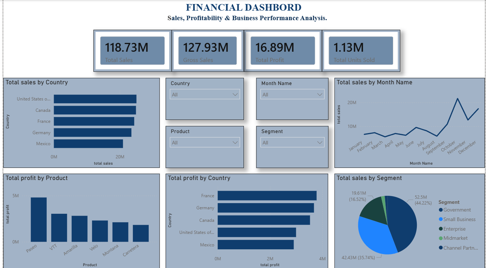

# Financial-Dashboard
Financial Dashboard – Sales, Profitability &amp; Business Performance Analysis

## 📊 Project Overview

This project presents an interactive Financial Dashboard developed using Microsoft Power BI to analyze sales performance, profitability, and business performance across different countries, products, and customer segments.

The dashboard helps understand financial performance through visualizations, key performance indicators (KPIs), and interactive filters.

## 📸 Dashboard Preview

## 🎯 Key Performance Indicators (KPIs)

- **Total Sales:** 118.73M
- **Gross Sales:** 127.93M
- **Total Profit:** 16.89M
- **Total Units Sold:** 1.13M

## 📈 Dashboard Features

- Total Sales by Country
- Total Sales by Month
- Total Sales by Business Segment
- Total Profit by Product
- Total Profit by Country
- Interactive filters for Country, Month, Product, and Segment.

## 🛠️ Tools & Technologies

- Microsoft Power BI
- Microsoft Excel
- Data Visualization
- Business Intelligence
- Financial Data Analysis

## 📂 Project Files

| File Name | Description |
|---|---|
| Financial_Dashboard.pbix | Power BI dashboard file |
| Financial_Dashboard.png | Dashboard preview image |
| Financial_Dataset.xlsx | Source dataset |

## 💡 Key Insights

- Identified sales performance across different countries.
- Compared profitability across products.
- Analyzed monthly sales trends.
- Evaluated revenue contribution across business segments.
- Identified variations in country-wise profitability.

## 🎓 Learning Outcomes

- Developed an interactive Power BI dashboard.
- Practiced KPI development and data visualization.
- Improved financial and business performance analysis skills.
- Gained practical experience in presenting data-driven insights.

## 👩‍💻 Author

**Vaishnavi Mokhashi**

MBA | Finance & Marketing | Aspiring Data Analyst

